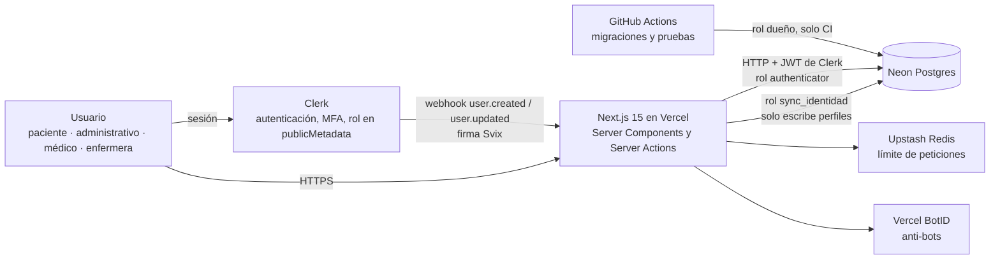
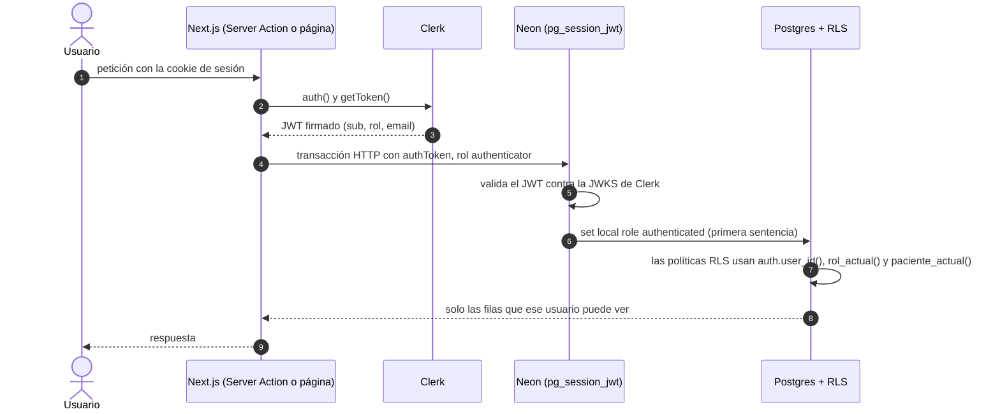

# Arquitectura y contexto de usuario para RLS

Cómo llega la identidad del usuario hasta Postgres. Es la pieza central de seguridad del sistema: la aplicación **no** decide quién ve qué
fila, lo decide la base de datos. Decisiones: [ADR-0020](../03-arquitectura/adrs/0020-arquitectura-de-componentes-y-hosting-vercel.md),
[ADR-0022](../03-arquitectura/adrs/0022-autenticacion-y-sesion-clerk.md) y [ADR-0023](../03-arquitectura/adrs/0023-contexto-de-usuario-para-rls.md).
Código: [`lib/db/cliente-autenticado.ts`](../../lib/db/cliente-autenticado.ts) y [`app/api/webhooks/clerk/route.ts`](../../app/api/webhooks/clerk/route.ts).

## Componentes

## Una consulta autenticada, de punta a punta

## Por qué es seguro

- `authenticator` no tiene privilegios sobre ninguna tabla: si una consulta olvidara `set local role authenticated`, falla cerrada.
- Solo HTTP, una sesión por petición: ninguna conexión reutilizada puede conservar la identidad de otro usuario.
- El rol sale de `publicMetadata` (el usuario no puede escribirlo); el correo, del claim que valida Neon, nunca de un parámetro.
- Cada tabla del esquema `public` tiene RLS activada y su prueba negativa en pgTAP (`tests/pgtap/99_rls_en_todas_las_tablas.test.sql`).
