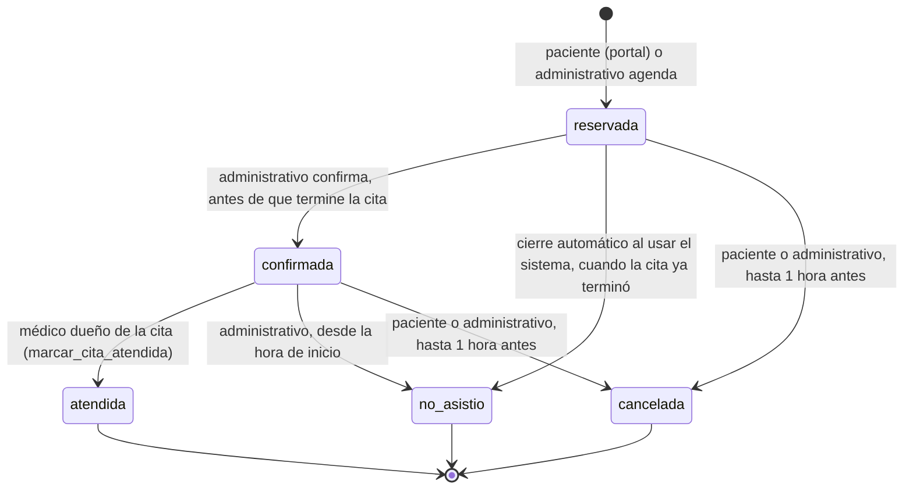

# Ciclo de estados de una cita

El enum `estado_cita` y quién puede mover cada transición. La regla vive en la base de datos (disparadores `validar_transicion_estado()` y
`validar_cancelacion()`, más la función `marcar_cita_atendida()`), no en la aplicación. Origen:
[`migrations/1792341900000_transiciones-de-estado-de-cita.sql`](../../migrations/1792341900000_transiciones-de-estado-de-cita.sql),
[`1792536200000_portal-paciente-cancelacion.sql`](../../migrations/1792536200000_portal-paciente-cancelacion.sql) y
[ADR-0012](../03-arquitectura/adrs/0012-alcance-de-la-ventana-de-cancelacion.md) (ventana de 1 hora para todos los roles).

Notas:

- La ventana de 1 hora no aplica si un bloqueo de agenda del médico (baja o emergencia) cubre la cita: se reasigna o se cancela
  ([ADR-0011](../03-arquitectura/adrs/0011-reasignacion-de-citas-por-baja-medica.md)).
- Desde el portal, el paciente solo cancela citas que aún no empiezan (`inicio > now()`).
- Pasar a `confirmada` es el hecho que concede al médico acceso a la historia clínica del paciente
  ([ADR-0016](../03-arquitectura/adrs/0016-vigencia-de-asignacion-paciente-medico.md)).
- Nadie, ni el administrativo, puede escribir `atendida` con un `UPDATE` directo.
