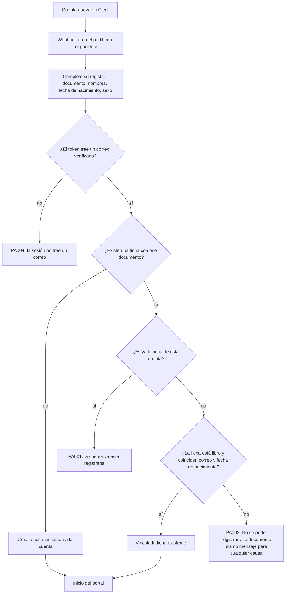

# Registro del paciente y vinculación con su ficha

Qué pasa cuando una cuenta nueva completa sus datos en «Complete su registro». La función `registrar_paciente_portal` decide en la base de datos
si crea una ficha nueva o vincula una existente, y todos los rechazos de vinculación devuelven el mismo error para no revelar qué dato falló
([ADR-0037](../03-arquitectura/adrs/0037-verificacion-al-vincular-una-ficha-de-paciente.md)). Código:
[`migrations/1792536080588_portal-paciente-vinculacion.sql`](../../migrations/1792536080588_portal-paciente-vinculacion.sql) y
[`lib/portal/registro.ts`](../../lib/portal/registro.ts).

Riesgo conocido, pendiente de decisión del cliente: la rama «no existe ficha» no comprueba que el documento pertenezca a quien se registra
(hallazgo SEC-02 del [informe de seguridad](../08-seguridad/SECURITY-REPORT.md)).
