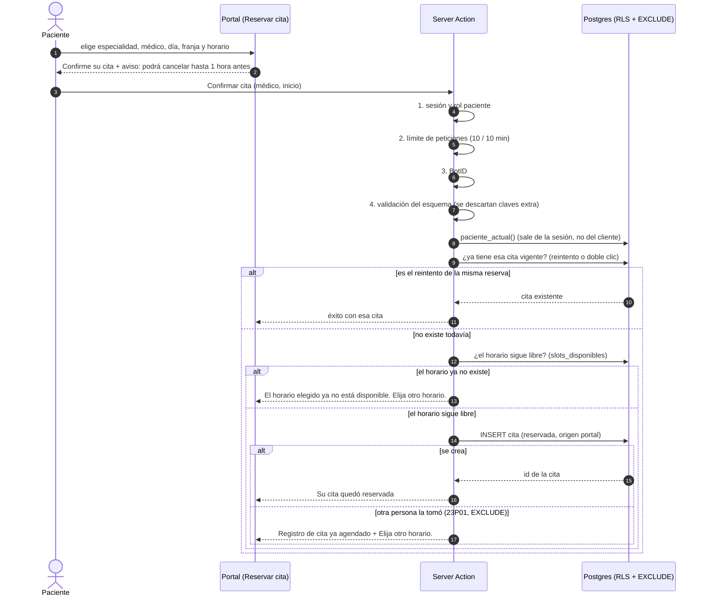

# Reserva de una cita desde el portal del paciente

Secuencia de la Server Action `reservarCitaDelPortal`. Reglas que el diagrama deja visibles: el orden de los controles de borde (sesión, límite,
anti-bots), que el paciente sale de la sesión y no de la petición, y que la doble reserva la decide el motor de base de datos
([ADR-0005](../03-arquitectura/adrs/0005-modelo-de-datos-y-prevencion-de-doble-reserva.md)).
Código: [`lib/portal/reserva.ts`](../../lib/portal/reserva.ts), [`lib/auth/accion-paciente.ts`](../../lib/auth/accion-paciente.ts) y
[`app/paciente/citas/nueva/`](../../app/paciente/citas/nueva/).

