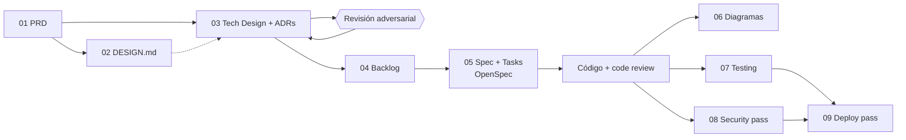

# Documentación — pipeline AI-First

Esta carpeta está ordenada en el mismo orden en que se construyó el proyecto. Cada paso **consume el documento anterior**: ninguno es un
documento suelto. Si el PRD cambia, el diseño técnico, el backlog y las specs tienen que responder a ese cambio.

## Los pasos

| # | Carpeta | Artefacto | Cómo se generó | Consume |
|---|---|---|---|---|
| 01 | [`01-producto/`](01-producto/) | [`PRD.md`](01-producto/PRD.md) | Skill `generar-prd-conversacional` | La necesidad de la clínica |
| 02 | [`02-diseno/`](02-diseno/) | [`DESIGN.md`](02-diseno/DESIGN.md), [`BRIEF-DISENO.md`](02-diseno/BRIEF-DISENO.md) y el [`lienzo/`](02-diseno/lienzo/) de nueve láminas | Revisión visual aprobada el 2026-10-18; el CSS del tema se genera con `npm run tema` | PRD |
| 03 | [`03-arquitectura/`](03-arquitectura/) | [`TECH-DESIGN.md`](03-arquitectura/TECH-DESIGN.md) + [`adrs/`](03-arquitectura/adrs/) (25 ADR) | Skill `generar-tech-design` (decisión por decisión) + `revision-adversarial` | PRD (+ DESIGN) |
| 04 | [`04-backlog/`](04-backlog/) | [`BACKLOG.md`](04-backlog/BACKLOG.md): 35 ítems en 8 hitos | Skill `generar-backlog`, ordenado por dependencias | PRD + TECH-DESIGN + ADRs |
| 05 | [`05-specs/`](05-specs/) | [`openspec/`](../openspec/) en la raíz | OpenSpec: `propose → apply → archive`, un change por hito | Un ítem del BACKLOG |
| 06 | [`06-diagramas/`](06-diagramas/) | Arquitectura y RLS, reserva del portal, estados de la cita, registro del paciente | Mermaid, dibujado sobre el código real | Código |
| 07 | [`07-testing/`](07-testing/) | [`README`](07-testing/README.md) + las pruebas de [`tests/`](../tests/) y [`e2e/`](../e2e/) | pgTAP, `node:test` y Playwright | PRD (reglas de negocio y casos borde) |
| 08 | [`08-seguridad/`](08-seguridad/) | [`SECURITY-REPORT.md`](08-seguridad/SECURITY-REPORT.md) | Skill `security-pass` (solo análisis, con evidencia) | Código + TECH-DESIGN |
| 09 | [`09-deploy/`](09-deploy/) | [`DEPLOY-PLAN.md`](09-deploy/DEPLOY-PLAN.md) + los pasos manuales por hito | Skill `deploy-pass` (diseña antes de ejecutar) | Código + tests + SECURITY-REPORT |

En la raíz quedan los archivos que leen las herramientas, no las personas: [`CLAUDE.md`](../CLAUDE.md) (contexto y reglas para el agente) y
[`README.md`](../README.md) (portada del proyecto).

## Trazabilidad: cómo se ve que un documento «responde» al anterior

Un ejemplo real de este repositorio, de punta a punta:

1. **PRD**, regla de negocio: *dos personas no pueden reservar el mismo horario; el segundo intento debe fallar con el mensaje exacto
   «Registro de cita ya agendado»*.
2. **TECH-DESIGN**, [ADR-0005](03-arquitectura/adrs/0005-modelo-de-datos-y-prevencion-de-doble-reserva.md): se resuelve con una restricción
   `EXCLUDE` en la base de datos, no con un chequeo previo en la aplicación.
3. **BACKLOG**, ítem 9: *«Agendar cita con anticruce»*, y el ítem 16 para el portal del paciente.
4. **OpenSpec**: change [`2026-10-20-agenda-y-reserva`](../openspec/changes/archive/2026-10-20-agenda-y-reserva/) → spec vigente
   [`gestion-de-citas`](../openspec/specs/gestion-de-citas/spec.md).
5. **Diagrama**: [reserva desde el portal](06-diagramas/reserva-portal-secuencia.md) muestra dónde actúa el motor de base de datos.
6. **Pruebas**: [`tests/concurrencia/10_doble_reserva.test.ts`](../tests/concurrencia/10_doble_reserva.test.ts) (dos reservas simultáneas, una
   gana), [`tests/integracion/reservas.test.ts`](../tests/integracion/reservas.test.ts) (el literal exacto) y
   [`e2e/portal-reserva.spec.ts`](../e2e/portal-reserva.spec.ts) (dos pacientes reales).
7. **Seguridad y deploy**: el [informe de seguridad](08-seguridad/SECURITY-REPORT.md) revisa que esa regla no se pueda saltar, y el
   [plan de despliegue](09-deploy/DEPLOY-PLAN.md) cuida que las migraciones que la sostienen lleguen a producción antes de usarse.

## Sobre las skills y las rutas

Las skills del curso escriben por defecto en la raíz del repositorio (`PRD.md`, `TECH-DESIGN.md`, `adrs/`, `SECURITY-REPORT.md`,
`DEPLOY-PLAN.md`). En este proyecto se movieron a su carpeta numerada. Al usar una skill, indícale la ruta de destino; `CLAUDE.md` ya se lo
recuerda al agente.
